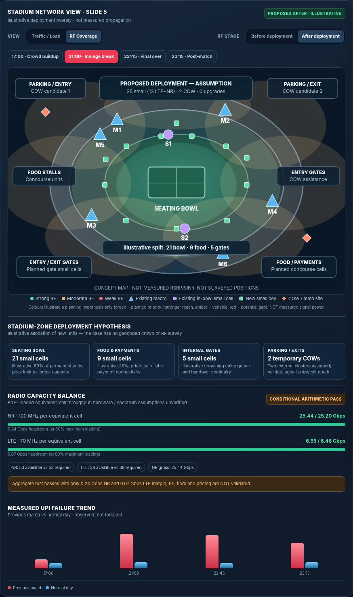

# SYNC-SHIELD — Stadium Network Decision Twin

An interactive, **offline / GitHub Pages-ready** decision-support demo aligned to the reviewed 7-slide **Airtel SYNC 2026 · Network Case 1: Stadium Surge** submission.

**[Open the simulator](index.html)** · No backend, API key, database, package installation, or build step. The entire application lives in `index.html`.

## Matches the reviewed final PowerPoint

The default **Hybrid A** scenario reproduces the deck's conditional infrastructure proposal:

| Item | Default | Provenance |
|---|---:|---|
| Spectators | 100,000 | Airtel case |
| Airtel share | 40% | Airtel case |
| Peak active share | 18% | Airtel case |
| 5G-capable share | 70% | Airtel case |
| Target service | 5 Mbps NR, 3 Mbps LTE | Airtel case |
| Maximum planned radio load | 80% | Airtel task |
| Full-demand NR / LTE throughput | 25.20 / 6.48 Gbps | Calculated from case |
| Existing radio equivalents | 12 NR / 20 LTE | **Unverified:** inferred 3-sector macro model |
| New small cells | **35**, of which **13 LTE+NR** | Proposed; equipment capability and price unverified |
| Temporary COWs | **2**, assumed 3 NR + 3 LTE sectors each | Proposed; sector capabilities unverified |
| Macro upgrades | 0 | Preferred plan |
| New fibre | 0.5 km | **Illustrative route allowance**, not surveyed |
| Tests/contingency | ₹20 lakh | Assumed allowance |
| Total cost | **₹375 lakh = ₹3.75 crore** | ₹280L cells + ₹50L COWs + ₹25L fibre + ₹20L tests |
| Remaining budget | **₹25 lakh** | Calculated |

Assumed effective spectral efficiencies of 6 b/s/Hz NR and 3 b/s/Hz LTE imply 0.480 / 0.168 Gbps per equivalent cell **at 80% planned loading**. On the assumed 53 NR / 39 LTE cell configuration, planned capacity is **25.440 Gbps NR / 6.552 Gbps LTE**, leaving only **+0.240 / +0.072 Gbps**. These margins are extremely narrow; do **not** describe this as guaranteed capacity or a validated deployable design.

## Demo in 90 seconds

1. **Previous match · measured:** Show seven sites near 99% LTE load at innings break versus M6 at 60.5%, and n78 connection success averaging 36.2%.
2. **Final · simulated:** Default is the reviewed-deck Hybrid A proposal. Read the NR, LTE and budget panels: exactly ₹3.75 Cr and the very small margins above.
3. **RF Coverage → Before/After:** Show representative seating-bowl, food/payment, entry/exit and parking deployment priorities; these are **illustrative**, not measured RSRP or SINR predictions.
4. **Compare competing architectures:** Examine fibre-only (41 small, 0 COW), Hybrid A (35+2) and Hybrid B (32+3). The 13, 19 and 10 dual-RAT counts are explicitly included in each model.
5. **Failure laboratory:** Test the unconfirmed worksheet `8 NR / 14 LTE` interpretation, 1-sector COW, 40 MHz usable LTE, NR spectral efficiency 5 b/s/Hz, 10% 5G fallback, or a macro failure. The arithmetic model should fail in most of these stress cases.
6. **EN-DC failure detective:** Select LTE, measurement, admission, or NR random-access bottlenecks to illustrate different *hypothetical* explanations of the same measured success KPI.
7. **Export scenario:** Download a JSON snapshot of exactly which assumptions were used, for auditability.

## GitHub Pages publication

1. Create a **public GitHub repository** (for example `sync-shield`).
2. Upload the **contents of this folder** into the repository root. In particular, `index.html` must be in the repository root — **not nested in an extra folder**.
3. Commit the files to your default branch (usually `main`).
4. Open **Settings → Pages**, select **Deploy from a branch**, choose `main` and `/(root)`, then save.
5. GitHub will provide a page URL typically shaped like `https://YOUR-USERNAME.github.io/sync-shield/` (actual URL depends on your repo). Test it in a private/incognito tab and on a phone.
6. Put that **public URL and a QR code** on slide 7 and verify that the PPT and PDF links work. Do not put a local file or ChatGPT sandbox URL into the competition slides.

**No secret, token, SIM, network authentication or live Airtel access is needed.** No data leaves the browser except a user-triggered local JSON download. The app is static HTML, CSS and vanilla JavaScript. All source case observations are bundled into the HTML.

## Evidence and limitations

The case supplies eight site descriptions, 32 site-phase measurements, four UPI failure readings, nominal spectrum and unit prices. It does **not** supply stadium coordinates, antenna directions, RF interference maps, actual LTE band availability per cell, COW radio configurations, dual-RAT small-cell pricing, fibre routes, permission status, or the real crowd distribution across stadium zones.

The workbook contains unlabeled `5G = 8` and `4G = 14` cells in addition to site records. These might relate to sector inventory but are **not sufficiently defined**. Use the baseline selector to show how the answer changes; the model does not assert they are definitely installed radio cells.

`PASS*` or `CONDITIONAL ARITHMETIC PASS` only means the scenario passes a **simplified aggregate throughput/budget calculation**. It does not establish real RF coverage, transport feasibility, payment success, emergency-call continuity, or procurement within 60 days. Existing microwave constraints are approximated only for optional macro upgrades. New small-cell and COW transport is not certified by the model.

See [MODEL_NOTES.md](MODEL_NOTES.md) for formulas and exact assumptions. The 60-day execution stages are in the slide deck; the app makes no claim of actual on-site deployment.
